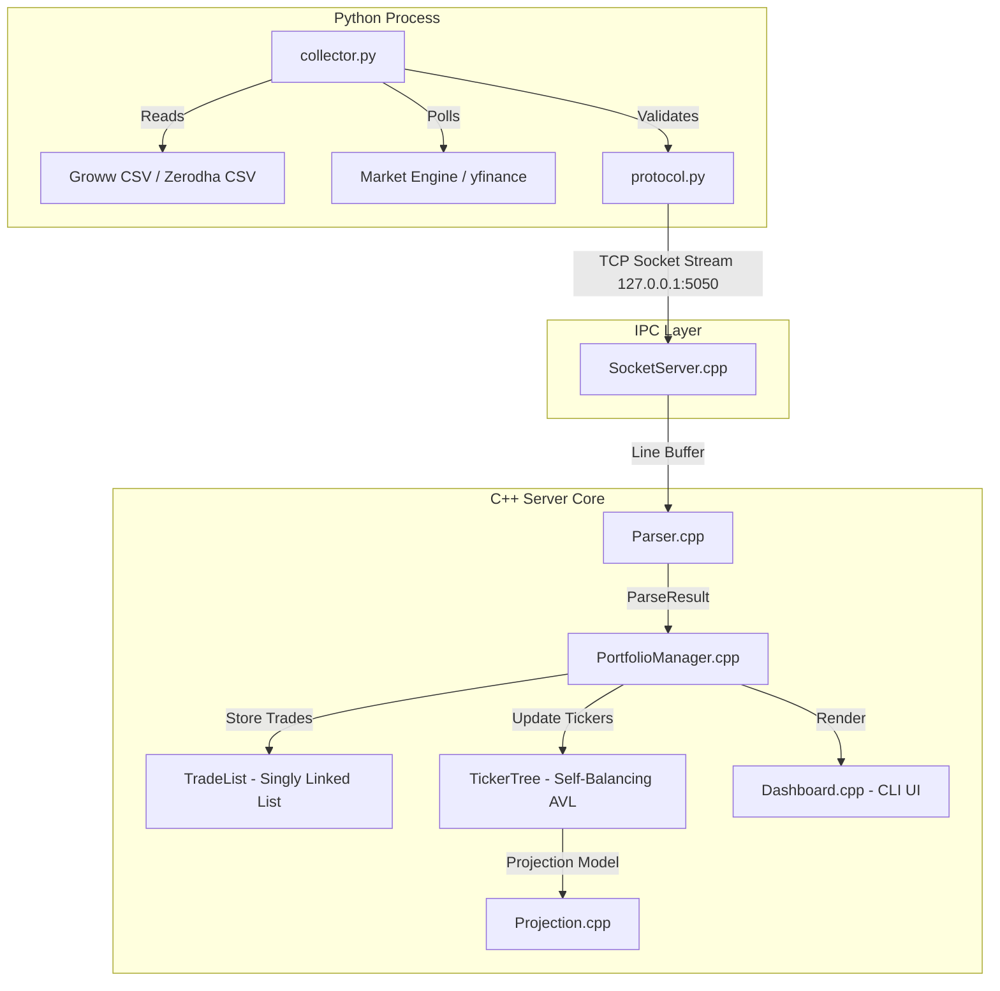

# PortSync System Architecture Document

## Overview
PortSync separates market data ingestion (Python) from analytical calculation and terminal visualization (C++). The two processes communicate over a local IPv4 TCP socket stream using a lightweight line-oriented wire protocol.

---

## Technical Design & Data Path

---

## C++ Core Architecture

### 1. `TradeList` (Singly Linked List)
- **Structure**: Nodes contain `Trade` instances and pointer to `next`. Maintains explicit `m_head` and `m_tail` pointers.
- **Append**: $O(1)$ constant time complexity using `m_tail`.
- **Chronological Insertion**: `insertSorted` inserts trades in $O(N)$ worst-case time by date string, preserving insertion order for identical trade dates (stability).

### 2. `TickerTree` (Self-Balancing AVL Tree)
- **Structure**: Nodes (`TickerNode`) are keyed alphabetically by stock ticker symbol.
- **Balancing**: Height tracking per node. Rebalances automatically via four tree rotations:
  - **Left-Left (LL)**: Single Right Rotation (`rotateRight`)
  - **Right-Right (RR)**: Single Left Rotation (`rotateLeft`)
  - **Left-Right (LR)**: Left Rotation on left child, followed by Right Rotation on node
  - **Right-Left (RL)**: Right Rotation on right child, followed by Left Rotation on node
- **Time Complexity**: Lookups (`find`), insertions (`insert`), and deletions (`remove`) are strictly bounded by $O(\log N)$.

### 3. `Printable` (Abstract Base Class)
- Abstract base class declaring pure virtual function `virtual std::string toString() const = 0`.
- Inherited by `Trade`, `Holding`, and `NewsItem`.
- `Dashboard` processes streams of `const Printable*` pointers to demonstrate **polymorphic virtual method dispatch**.

---

## Memory Safety & RAII Strategy

- **Sole Ownership Model**: Containers (`TradeList`, `TickerTree`) own their allocated nodes via raw pointers. Copy constructors and copy assignment operators are explicitly deleted (`= delete`).
- **Clean Destruction**: `TradeList::~TradeList()` sequentially deletes all list nodes. `TickerTree::~TickerTree()` performs recursive post-order tree deletion.
- **Sanitizer Verification**: System compiles with `-fsanitize=address,undefined` to guarantee zero memory leaks or undefined behaviors.
