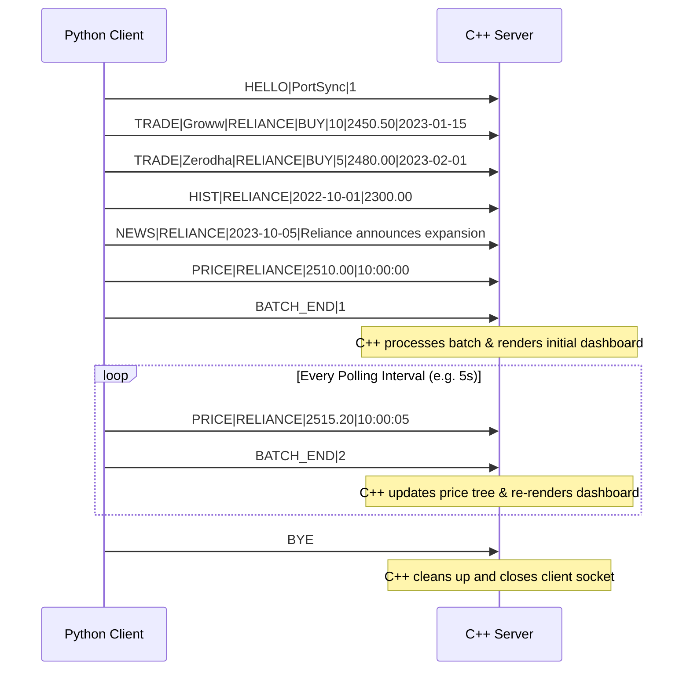

# PortSync Wire Protocol Specification

**Transport Layer**: TCP over IPv4 (`127.0.0.1:5050` by default).  
**Encoding**: UTF-8 plain text.  
**Delimiters**: Lines are terminated by `\n`. Fields within a line are separated by pipe `|`.  
**Sanitization**: Any `|` or newline characters within text fields (e.g. news headlines) are replaced with spaces by the sender before transmission.

---

## Message Schemas

### 1. `HELLO`
Handshake sent by the Python client upon establishing connection.
```text
HELLO|<app_name>|<protocol_version>
```
*Example*: `HELLO|PortSync|1`

### 2. `TRADE`
Historical or active trade records sent during initial sync.
```text
TRADE|<broker>|<ticker>|<BUY|SELL>|<qty>|<price>|<YYYY-MM-DD>
```
*Example*: `TRADE|Groww|RELIANCE|BUY|10|2450.50|2023-01-15`

### 3. `HIST`
Historical daily closing prices (used for CAGR 1-year estimates).
```text
HIST|<ticker>|<YYYY-MM-DD>|<close_price>
```
*Example*: `HIST|TCS|2023-01-02|3200.00`

### 4. `NEWS`
Recent market news or ticker headline updates.
```text
NEWS|<ticker>|<YYYY-MM-DD>|<headline>
```
*Example*: `NEWS|INFY|2023-10-01|Infosys reports Q2 profit growth`

### 5. `PRICE`
Near-real-time ticker price update (sent periodically).
```text
PRICE|<ticker>|<price>|<HH:MM:SS>
```
*Example*: `PRICE|HDFCBANK|1620.75|14:30:00`

### 6. `BATCH_END`
Signals completion of a data transmission batch. C++ re-renders the dashboard upon receiving `BATCH_END`.
```text
BATCH_END|<seq_number>
```
*Example*: `BATCH_END|1`

### 7. `BYE`
Termination request.
```text
BYE
```

---

## Communication Flow


